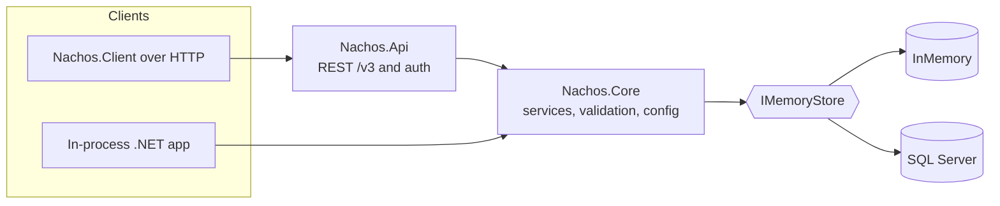

<div align="center">
  

  <h1>Nachos</h1>
  <p>
    <b>Memory for stateful agents, built on .NET and Azure.</b>
  </p>

[](global.json)
[](src/DataLayer/Nachos.DataLayer.SqlServer)
[](https://github.com/brendankowitz/nachos/issues/2)
[](https://github.com/brendankowitz/nachos/actions/workflows/ci.yml)
[](LICENSE)

</div>

---

> **Status: pre-release source MVP (milestone M1).** No packages are published: no NuGet packages, no container images, no tagged release. Build it from this repository. The [documentation site](https://brendankowitz.github.io/nachos/) is published from `main`. Azure definitions in [`infra/`](infra) are validated offline only. The project is developed with AI agents under manual review, and it is a clean-room implementation of the [Honcho](https://honcho.dev) v3 API shape. No Honcho source is included; see [License](#-license) below.

---

## Overview

**Nachos** is an independent, MIT-licensed .NET 10 memory service for stateful agents. It stores workspaces, peers, sessions and messages, and you can embed it in a process or run it as an HTTP API you host yourself.

The same `INachosClient` surface is implemented in-process and over HTTP. Storage is either a non-durable in-memory provider or SQL Server, with the schema owned by a database project. Authentication fails closed unless you explicitly disable it for local development.

Reasoning is not in this milestone. Conclusions, dialectic chat, search, context, summaries, dreaming, webhooks, scopes and MCP answer `501 Not Implemented`. The [design spec](docs/superpowers/specs/2026-10-07-nachos-design.md) describes that later end state. The [documentation site](https://brendankowitz.github.io/nachos/) is built from [`docs/site`](docs/site).

## ✨ What works today

### 🔌 Honcho-shaped API

- **Workspaces, peers, sessions and messages** under `/v3`: get-or-create, list, update, session membership and per-peer session config.
- **Idempotent message batches.** An `Idempotency-Key` replays the captured response for 24 hours when the body and target match.
- **Stable gaps.** Routes that are not built yet return `501`, not `404`, so clients can tell "later" from "unknown".
- **Local inspectability.** In `Development`: `/health`, `/health/live`, `/health/ready`, and OpenAPI at `/openapi/v1.json`.

### 🧩 Embeddable .NET library

- In-process hosting with `AddNachos` and a scoped `INachosClient`.
- The same interface over HTTP with `AddNachosClient`, including bounded retries for requests that are safe to repeat.
- Reference the projects directly. Nothing is on NuGet yet.

### 🗄️ Storage you can choose

- **In-memory** for tests and local experiments. It is not durable, and it warns at startup outside `Development`.
- **SQL Server**, with DDL owned by database projects and deployed from an embedded dacpac.
- An [Aspire](https://aspire.dev) AppHost that starts SQL Server 2025 and the API for local development.

### 🔐 Authentication that fails closed

- **NachosKey** bearer tokens and **Microsoft Entra** bearer tokens. An unauthenticated `/v3` call is rejected.
- Offline key minting and role grants from the `nachos` CLI, plus `POST /v3/keys` and `POST /v3/admin/grants`.
- `Nachos:Auth:Enabled=false` is accepted only when `ASPNETCORE_ENVIRONMENT` is `Development`. Any other environment refuses to start with authentication off.

### ☁️ Azure definitions, not a supported deploy

[`infra/`](infra) and [`azure.yaml`](azure.yaml) describe Container Apps and Azure SQL for `azd`. They have been checked offline. Deploying them creates cloud resources and needs the repository owner's explicit approval. Do not treat that path as verified.

## Still ahead

These are specified and, where a route exists, return **501**:

| Area | Staged surface |
| --- | --- |
| Conclusions | create, list, query, get, delete |
| Reasoning | workspace, peer and session chat, search, context, representation, summaries |
| Peer cards | get and put `card` |
| Sessions | delete, clone, `messages/upload`; a create with nonempty `scopes` |
| Scopes | create, list, get, status, and scope-session link, list, delete |
| Webhooks | list, create, test, delete |
| Workspace ops | delete, `queue/status`, `schedule_dream`, `jobs` |

The exact method and path pairs live in [`NotImplementedEndpoints.cs`](src/Nachos.Api/Endpoints/NotImplementedEndpoints.cs).

## 🛠️ Quick start

### Prerequisites

- **[.NET SDK 10.0.100](https://dotnet.microsoft.com/download/dotnet/10.0) or a later feature band**, per [`global.json`](global.json) (`rollForward: latestFeature`).
- **Docker**, for the AppHost and for the SQL Server tests (Testcontainers). The in-memory path does not need it.

### Build and test

```bash
dotnet build Nachos.slnx -c Release
dotnet test Nachos.slnx -c Release
```

SQL Server tests start containers, so Docker must be running. Infrastructure tests that compile Bicep need a Bicep CLI of 0.48.1 or later on `PATH`.

### Run the API locally

Authentication is on by default. This demo turns it off **in `Development` only**, binds loopback, and uses the in-memory store because no SQL connection string is set. Data disappears when the process stops. Do not point it at real user data.

PowerShell:

```powershell
$env:ASPNETCORE_ENVIRONMENT = "Development"
$env:Nachos__Auth__Enabled = "false"
dotnet run --project src/Nachos.Api --urls http://127.0.0.1:5080
```

bash / zsh:

```bash
ASPNETCORE_ENVIRONMENT=Development Nachos__Auth__Enabled=false \
  dotnet run --project src/Nachos.Api --urls http://127.0.0.1:5080
```

In another terminal (in PowerShell, call `curl.exe`, not the `curl` alias):

```bash
curl -s -X POST http://127.0.0.1:5080/v3/workspaces \
  -H "Content-Type: application/json" -d '{"id":"demo"}'
curl -s -X POST http://127.0.0.1:5080/v3/workspaces/demo/peers \
  -H "Content-Type: application/json" -d '{"id":"alice"}'
curl -s -X POST http://127.0.0.1:5080/v3/workspaces/demo/sessions \
  -H "Content-Type: application/json" -d '{"id":"s1","peers":{"alice":{}}}'
curl -s -X POST http://127.0.0.1:5080/v3/workspaces/demo/sessions/s1/messages \
  -H "Content-Type: application/json" \
  -d '{"messages":[{"peer_id":"alice","content":"hello"}]}'
curl -s -X POST http://127.0.0.1:5080/v3/workspaces/list \
  -H "Content-Type: application/json" -d '{}'
```

To call an authenticated server, configure a signing key and send a NachosKey minted with that same secret. See the [authentication guide](https://brendankowitz.github.io/nachos/guides/auth/).

The API selects SQL Server when `Nachos:SqlServer:ConnectionString` is set, or when `ConnectionStrings:nachos` is set (that is what the AppHost provides). A configured value that is blank or has no database fails startup. It does not fall back to memory.

### Run with Aspire and SQL Server

```bash
dotnet run --project src/Nachos.AppHost --launch-profile http
```

This starts the Aspire dashboard (`http://localhost:15180`; the login URL is printed in the console), a SQL Server 2025 container with a persistent data volume, and the API. In a Development run the AppHost deploys the schema and injects a signing key whose id is `dev`. It does **not** disable authentication, so `/v3` returns `401` until you present a NachosKey minted with that same secret and `--kid dev`. `GET /health/ready` reports `Healthy` once the schema is deployed. The API port is the one Aspire assigns; read it from the dashboard.

Use the in-memory commands above when you want to try the resources without minting a key.

## 💻 Use as a library

Nachos is not on NuGet. Reference the projects: [`Nachos.Hosting`](src/Nachos.Hosting), a provider such as [`Nachos.DataLayer.InMemory`](src/DataLayer/Nachos.DataLayer.InMemory), and optionally [`Nachos.Client`](src/Nachos.Client).

### In process

```csharp
using Microsoft.Extensions.DependencyInjection;
using Nachos.Abstractions;
using Nachos.Abstractions.Contracts;

var services = new ServiceCollection();
services.AddNachos(nachos => nachos.UseInMemory());

await using var provider = services.BuildServiceProvider();
await using var scope = provider.CreateAsyncScope();
var nachos = scope.ServiceProvider.GetRequiredService<INachosClient>();

await nachos.GetOrCreateWorkspaceAsync("demo");
await nachos.GetOrCreatePeerAsync("demo", "alice");
await nachos.GetOrCreateSessionAsync("demo", "s1");
await nachos.AddSessionPeersAsync("demo", "s1", new Dictionary<string, SessionPeerConfig> { ["alice"] = new() });
await nachos.CreateMessagesAsync("demo", "s1", [new MessageCreate("hello", "alice")]);

var page = await nachos.ListMessagesAsync("demo", "s1", filters: null, new PageRequest());
foreach (var message in page.Items)
{
    Console.WriteLine($"{message.PeerId}: {message.Content}");
}
```

`INachosClient` is scoped. In-process callers are trusted application code: the HTTP authentication middleware is not part of this mode. For durable storage, reference [`Nachos.DataLayer.SqlServer`](src/DataLayer/Nachos.DataLayer.SqlServer) and call `UseSqlServer(options => options.ConnectionString = "...")`.

### Over HTTP

```csharp
services.AddNachosClient(options =>
{
    options.BaseAddress = new Uri("https://nachos.example.com"); // your server's root
    options.ApiKey = Environment.GetEnvironmentVariable("NACHOS_API_KEY");
    // options.Credential = ...;      // an Entra TokenCredential (with options.Scopes)
});
```

Register this **instead of** in-process `AddNachos`. Do not embed a key in source.

## Command line

The `nachos` CLI is bootstrap tooling. It is run from source (it is not packaged as a .NET tool yet):

```bash
dotnet run --project src/Nachos.Cli -- --help
```

| Command | What it does |
| --- | --- |
| `schema status --connection <cs>` | Prints the database's schema position as JSON. |
| `schema report --connection <cs> [--out <file>]` | Shows what a deploy would change, without changing anything. |
| `schema upgrade --connection <cs> [--report-only] [--approve-reviewed] [--allow-data-loss] [--adopt-unstamped]` | Applies the schema. Exit `0`: applied or nothing to do; `2`: refused; `1`: error. |
| `keys create [--admin] [--workspace <id>] [--peer <id> \| --session <id>] [--kid <id>] [--expires <time>] --signing-secret-env <var>` | Mints a key offline and writes only the token to standard output. |
| `grants add --connection <cs> --object-id <id> --role <Nachos.Admin\|Nachos.Workspace> [--workspace <id>]` | Grants a role (idempotent). |
| `grants remove` (same options as `add`) | Removes a grant (idempotent). |
| `grants list --connection <cs> [--object-id <id>]` | Prints grants as JSON. |

Run `--help` on any command for the full options. The API accepts a minted token when its signing ring contains the same key id and secret.

## 🏗️ Architecture



| Project | Role |
| --- | --- |
| [`Nachos.Abstractions`](src/Nachos.Abstractions) | Domain records, request and response contracts, `INachosClient`, store interfaces, filters. |
| [`Nachos.Core`](src/Nachos.Core) | In-process `INachosClient`, validation, configuration resolution, key issuing, token counting. |
| [`Nachos.Hosting`](src/Nachos.Hosting) | `AddNachos(...)` and the provider builder. |
| [`Nachos.DataLayer.InMemory`](src/DataLayer/Nachos.DataLayer.InMemory) | Non-durable provider for tests and development. |
| [`Nachos.DataLayer.SqlServer`](src/DataLayer/Nachos.DataLayer.SqlServer) | SQL Server provider and the `SchemaDeployer`. |
| [`Nachos.DataLayer.SqlServer.Database`](src/DataLayer/Nachos.DataLayer.SqlServer.Database) and [`.Sql2025`](src/DataLayer/Nachos.DataLayer.SqlServer.Database.Sql2025) | Database projects that own the DDL and produce the embedded dacpacs. |
| [`Nachos.Api`](src/Nachos.Api) | ASP.NET Core minimal API for `/v3`, authentication and idempotency. |
| [`Nachos.Client`](src/Nachos.Client) | HTTP implementation of `INachosClient`. |
| [`Nachos.Cli`](src/Nachos.Cli) | The `nachos` bootstrap command line. |
| [`Nachos.AppHost`](src/Nachos.AppHost) | Aspire local-development host (SQL Server 2025 plus the API). |
| [`Nachos.ServiceDefaults`](src/Nachos.ServiceDefaults) | OpenTelemetry, health checks, shared service defaults. |
| [`infra/`](infra), [`azure.yaml`](azure.yaml) | Bicep and `azd` definitions for Azure Container Apps and Azure SQL. |

The full design is in [`docs/superpowers/specs/2026-10-07-nachos-design.md`](docs/superpowers/specs/2026-10-07-nachos-design.md). Milestone plans are in [`docs/superpowers/plans/`](docs/superpowers/plans).

## ✅ Compatibility and limits

A minimal smoke suite drives the upstream Python (`honcho-ai` 2.5.1) and TypeScript (`@honcho-ai/sdk` 2.5.1) SDKs against Nachos from [`test/conformance`](test/conformance). That subset is not full conformance ([#11](https://github.com/brendankowitz/nachos/issues/11)). Legacy `/v2` is tracked in [#4](https://github.com/brendankowitz/nachos/issues/4). Intentional behavior differences are listed in section 9.4 of the design spec.

| Limit | What you will see |
| --- | --- |
| Tokenizer | `token_count` uses an interim `Microsoft.ML.Tokenizers` o200k counter in ordinary-text mode. Special-token spellings such as `<\|endoftext\|>` count as ordinary text. The embedded vocabulary is checked against a pinned SHA-256 and fails closed if it is missing or altered. Quadratic work per pre-token segment, ignored cancellation, and supplementary-Unicode parity remain a release gate: [#10](https://github.com/brendankowitz/nachos/issues/10). |
| SQL filters | A metadata key longer than 4000 UTF-16 code units, or a single filter with more than 2000 SQL parameters, is rejected with `422`. A pathological unmergeable filter, or a long `contains` / `icontains` operand over repetitive text, can hit the 30 second command timeout and surface as `500` rather than `422`: [#18](https://github.com/brendankowitz/nachos/issues/18). |
| Pre-release schema | The schema version stays `1` until the first release, so a database created by an earlier M1 build reads as current. Take the reviewed path once: `schema report`, then `schema upgrade --approve-reviewed`. New databases need nothing. See section 7.3 of the design spec. |

## Release holds

[`THIRD-PARTY-NOTICES.md`](THIRD-PARTY-NOTICES.md) records the scoped notices for `Microsoft.SqlServer.DacFx`, the SqlClient SNI runtime and `Microsoft.SqlServer.Types`. It is not a complete dependency inventory.

No binaries or container images are distributed yet:

- The governing terms of `Microsoft.SqlServer.Types` 170.1000.7 are unresolved (its embedded licence is a pre-release evaluation document), which blocks artifacts that contain it: [#15](https://github.com/brendankowitz/nachos/issues/15).
- `Microsoft.Identity.Client.NativeInterop` 0.20.6, observed transitively in the API and CLI outputs, has unresolved distribution terms: [#19](https://github.com/brendankowitz/nachos/issues/19). Accepting a license as engineering policy is not the same as having the publisher's distribution rights.
- The tokenizer above is a production-release gate ([#10](https://github.com/brendankowitz/nachos/issues/10)).

## Roadmap

| Theme | Issues |
| --- | --- |
| Parity | [#2](https://github.com/brendankowitz/nachos/issues/2) full Honcho v3 parity on .NET and Azure |
| Release gates | [#10](https://github.com/brendankowitz/nachos/issues/10) tokenizer, [#15](https://github.com/brendankowitz/nachos/issues/15) `Microsoft.SqlServer.Types`, [#19](https://github.com/brendankowitz/nachos/issues/19) distribution terms |
| Docs and conformance | [#11](https://github.com/brendankowitz/nachos/issues/11) SDK conformance, [#12](https://github.com/brendankowitz/nachos/issues/12) docs tooling |
| Storage and hosting | [#18](https://github.com/brendankowitz/nachos/issues/18) pathological SQL filters, [#7](https://github.com/brendankowitz/nachos/issues/7) revision-based Container App deployment |
| Request handling | [#8](https://github.com/brendankowitz/nachos/issues/8) and [#9](https://github.com/brendankowitz/nachos/issues/9) error-location and malformed-Unicode validation |
| Later | [#3](https://github.com/brendankowitz/nachos/issues/3) Honcho data import, [#4](https://github.com/brendankowitz/nachos/issues/4) legacy `/v2` |

Tooling and policy issues: [#13](https://github.com/brendankowitz/nachos/issues/13), [#14](https://github.com/brendankowitz/nachos/issues/14), [#17](https://github.com/brendankowitz/nachos/issues/17). No date is promised. The M1 plan is [`docs/superpowers/plans/2026-10-07-nachos-m1-foundation.md`](docs/superpowers/plans/2026-10-07-nachos-m1-foundation.md).

## 🤝 Contributing

Issues and pull requests are welcome. Please read the design spec first. The clean-room rule is absolute: do not read or copy Honcho's source, tests or prompt text when contributing. The upstream SDKs are external test clients only.

## 📄 License

Nachos is released under the [MIT License](LICENSE) © 2026 Brendan Kowitz. Third-party components keep their own licences; see [`THIRD-PARTY-NOTICES.md`](THIRD-PARTY-NOTICES.md).

## 🙏 Acknowledgments

Nachos is grateful to [Honcho](https://honcho.dev) and Plastic Labs for the concepts and the public API design it aims to be compatible with. No Honcho source or text is part of this repository.

---

<p align="center">
  <b>Nachos</b> — memory for stateful agents.
</p>
