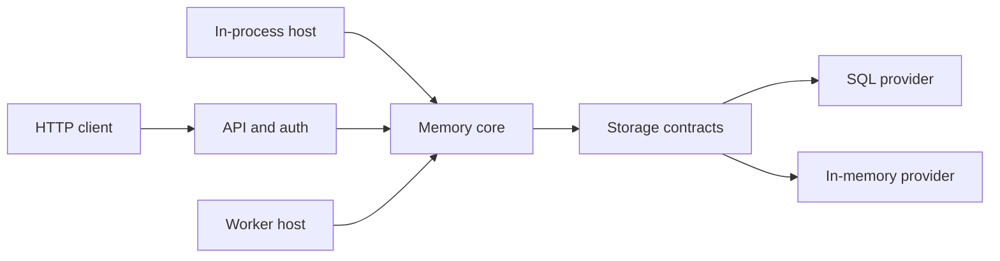

The diagram maps the implemented source-MVP boundaries. It does not imply
production deployment approval. The worker host (queue consumer and reconciler) is
described in [Memory formation](/nachos/concepts/memory-formation/).

| Boundary | Source-MVP responsibility |
| --- | --- |
| Abstractions | Wire contracts, domain values, and storage contracts |
| Core and hosting | Memory operations and in-process composition |
| API and client | HTTP hosting and a .NET transport client |
| Providers | SQL and in-memory implementations of the storage boundary |
| Worker | Queue consumer (Deriver) and reconciler against the same storage; the API runs them itself with the in-memory provider |
| CLI and AppHost | Bootstrap operations and local orchestration |

The full [approved design](https://github.com/brendankowitz/nachos/blob/main/docs/superpowers/specs/2026-10-07-nachos-design.md)
and [M1 implementation plan](https://github.com/brendankowitz/nachos/blob/main/docs/superpowers/plans/2026-10-07-nachos-m1-foundation.md)
remain in the source repository. The site links to these sources; it does not
republish research notes as product documentation.
Full spec/ADR publication is part of later documentation work.

There are no independent ADRs published here yet. For actual availability,
use [Introduction](/nachos/getting-started/introduction/) and
[Compatibility status](/nachos/reference/compatibility/).
