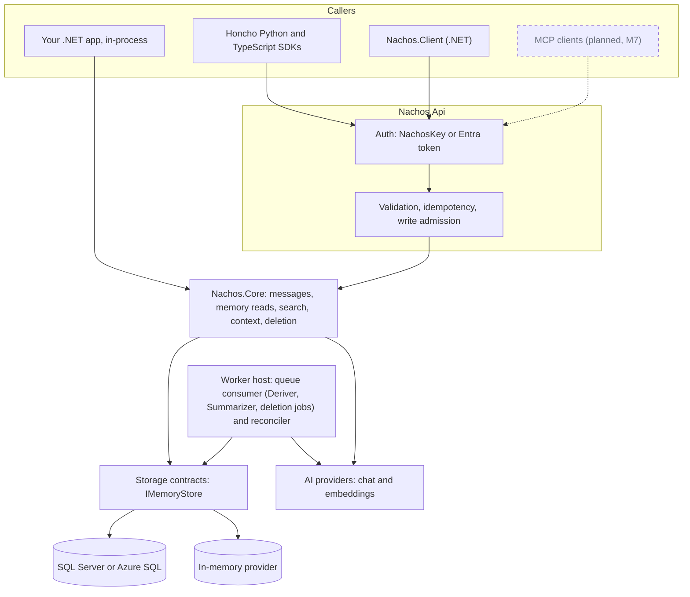
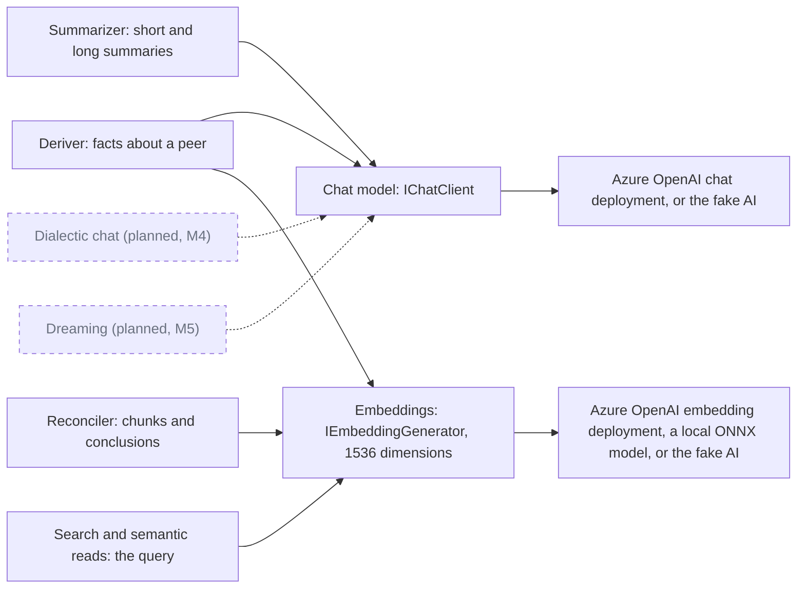
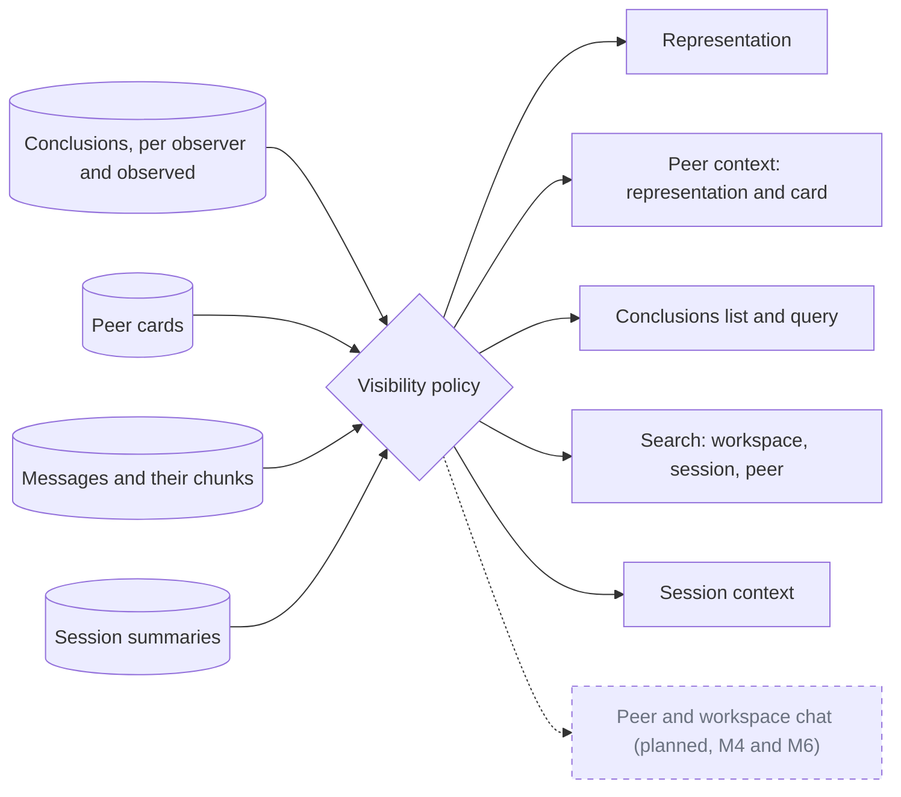
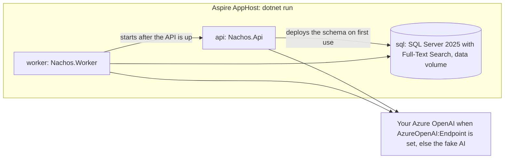
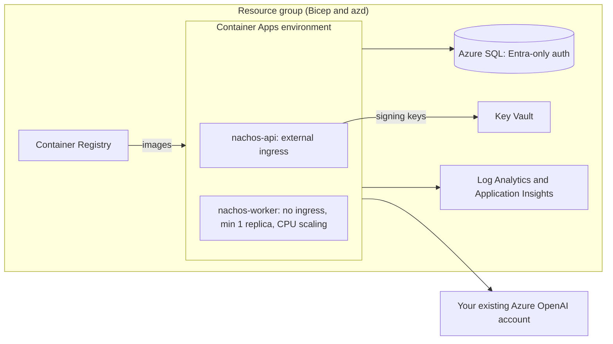

Nachos is one memory core with two front doors and one background worker. Callers reach the
core over HTTP through `Nachos.Api`, or in-process through `AddNachos()`. Every write is a short
database transaction. Everything slow, such as asking a model for facts, writing summaries,
embedding text or purging deleted data, is queued and done later by the worker. This page shows
the parts, what they read and write, and how they are deployed. It describes the source MVP; it
does not imply production deployment approval.

**Diagram key.** Solid boxes and arrows are built today. Dashed boxes and arrows marked
*(planned)* are designed but not built yet; the label names the milestone.

## The system at a glance

- **Callers.** Honcho's own Python and TypeScript SDKs call the `/v3` routes directly (see
  [Honcho SDKs](/nachos/guides/honcho-sdks/) and [Compatibility status](/nachos/reference/compatibility/)).
  `Nachos.Client` implements the same `INachosClient` interface over HTTP that `NachosService`
  implements in-process, so .NET code is the same in both modes ([Use it as a library](/nachos/getting-started/library/)).
- **API.** Authenticates a NachosKey (an HMAC-signed token from `nachos keys create`) or an Entra
  token, checks the key's reach against the route, validates the body, replays idempotent
  requests, and refuses writes under a resource that is being deleted. See [Authentication](/nachos/guides/auth/).
- **Core.** The memory operations: messages, conclusions, representations, peer cards, search,
  session context and deletion. Every read that returns memory passes through one visibility
  policy (see [Observation model](/nachos/concepts/observation-model/#who-can-read-what)).
- **Storage.** One set of contracts with two providers. SQL Server is the durable one; the
  in-memory provider keeps the same queue, lease and fencing rules, for tests and quick starts.
- **Worker.** Leases queued work and runs its handler; a singleton reconciler embeds what is
  still unembedded and cleans up. See [Memory formation](/nachos/concepts/memory-formation/).

## Who calls a model

Only two kinds of work call a chat model, and both run in the worker. Embeddings are needed in
more places, including on the request path to embed a search query.

Chat goes to Azure OpenAI or to the fake AI. Embeddings go to Azure OpenAI, to a
[local ONNX model](/nachos/guides/local-embeddings/), or to the fake AI's deterministic hashes. A
database records which embedding model produced its vectors, and a host with a different model
refuses to start. Without an embedding generator, search is lexical only and semantic reads answer
`503`.

## What comes out

Everything a caller reads back is assembled from four kinds of stored data, and every path goes
through the visibility policy first.

| Output | Route | Built from |
| --- | --- | --- |
| Representation | `POST /v3/workspaces/{id}/peers/{id}/representation` | One observer's conclusions about one peer, ranked and rendered as text |
| Peer context | `GET /v3/workspaces/{id}/peers/{id}/context` | The representation and the peer card |
| Conclusions | `POST .../conclusions/list` and `.../conclusions/query` | Conclusions, filtered, or nearest to a query |
| Search | `POST .../search` on a workspace, session or peer | Messages, by [hybrid search](/nachos/concepts/search/) |
| Session context | `GET .../sessions/{id}/context` | Messages, a summary, and optionally a representation and card, within a [token budget](/nachos/concepts/session-context/) |

## Deployment

Both deployments run the same two programs against one database: `Nachos.Api`, which serves
HTTP, and `Nachos.Worker`, which runs the queue consumer and the reconciler. With the in-memory
provider there is only the API, which then runs the worker loops itself, because another process
cannot see its memory.

### Locally, with Aspire

The AppHost builds SQL Server from `eng/docker/mssql-fts`, so full-text search works locally,
gives the API a development signing key, and points both hosts at Azure OpenAI or the fake AI.
See [Quick start](/nachos/getting-started/quick-start/) and [Run the worker](/nachos/guides/run-the-worker/).

### On Azure

The repository has Bicep for this shape. It builds and lints offline, but it has **not** been
shown to deploy successfully; see [Deploy to Azure](/nachos/getting-started/deploy-azure/).

Both apps reach Azure SQL, monitoring and Azure OpenAI; only the API reads Key Vault. They run as one user-assigned managed identity, which holds the SQL, Key Vault, registry and
(when the account is named) Azure OpenAI roles. Bicep does not create the Azure OpenAI account; it
takes an existing endpoint.

## Projects and boundaries

| Project | Responsibility |
| --- | --- |
| `Nachos.Abstractions` | Wire contracts, domain records, `INachosClient`, and the storage contracts (stores, work queue, search). Depends only on the .NET base library. |
| `Nachos.Core` | Memory operations, the Deriver, Summarizer and deletion handlers, the queue consumer and reconciler, hybrid search, session context, and the visibility policy. Never references SQL types. |
| `Nachos.Hosting` | `AddNachos()` and `AddNachosWorker()`: composition, AI provider selection and startup checks. |
| `Nachos.DataLayer.SqlServer` | The SQL Server provider: EF Core for query mapping, SqlClient for vectors, full-text, the queue and leases, and the schema deployer. |
| `Nachos.DataLayer.SqlServer.Database` (and `.Sql2025`) | The database project that owns all DDL, built as two dacpacs, for Azure SQL and SQL Server 2025. |
| `Nachos.DataLayer.InMemory` | The in-memory provider, with the same lease and fencing semantics. |
| `Nachos.Api` | HTTP hosting, authentication and authorization, idempotency and error shapes. Runs the worker loops itself with the in-memory provider. |
| `Nachos.Worker` | The worker host for SQL Server: queue consumer and reconciler. |
| `Nachos.Client` | The .NET HTTP client. |
| `Nachos.Cli` | The `nachos` tool: schema, keys, grants, embeddings and model downloads. |
| `Nachos.AppHost`, `Nachos.ServiceDefaults` | Local orchestration with Aspire; OpenTelemetry, health checks and resilience defaults. |

## What's built today

| Built (M1 to M3) | Planned |
| --- | --- |
| Workspaces, peers, sessions, memberships, messages | Dialectic chat, `P/chat` (M4) |
| Transactional queue, fenced leases, worker host, reconciler | Dreaming: deduction, induction, card refresh (M5) |
| Deriver, deduplication, conclusions, representation, peer cards set by you | Scopes, workspace chat, webhooks, upload (M6) |
| Summaries, hybrid search, session context, deletion jobs and `W/jobs` | MCP endpoint, approximate vector search, packaging (M7) |

## Design sources

The full [approved design](https://github.com/brendankowitz/nachos/blob/main/docs/superpowers/specs/2026-10-07-nachos-design.md)
and [M1 implementation plan](https://github.com/brendankowitz/nachos/blob/main/docs/superpowers/plans/2026-10-07-nachos-m1-foundation.md)
remain in the source repository. The site links to these sources; it does not
republish research notes as product documentation.
Full spec/ADR publication is part of later documentation work.

There are no independent ADRs published here yet. For actual availability,
use [Introduction](/nachos/getting-started/introduction/) and
[Compatibility status](/nachos/reference/compatibility/).
