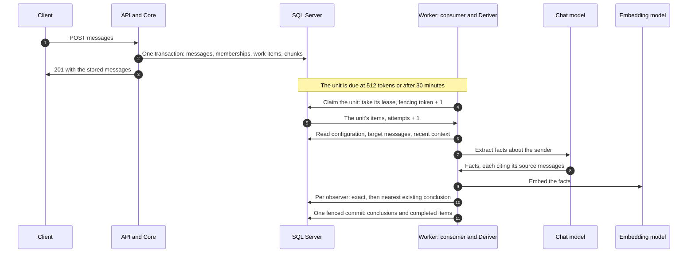
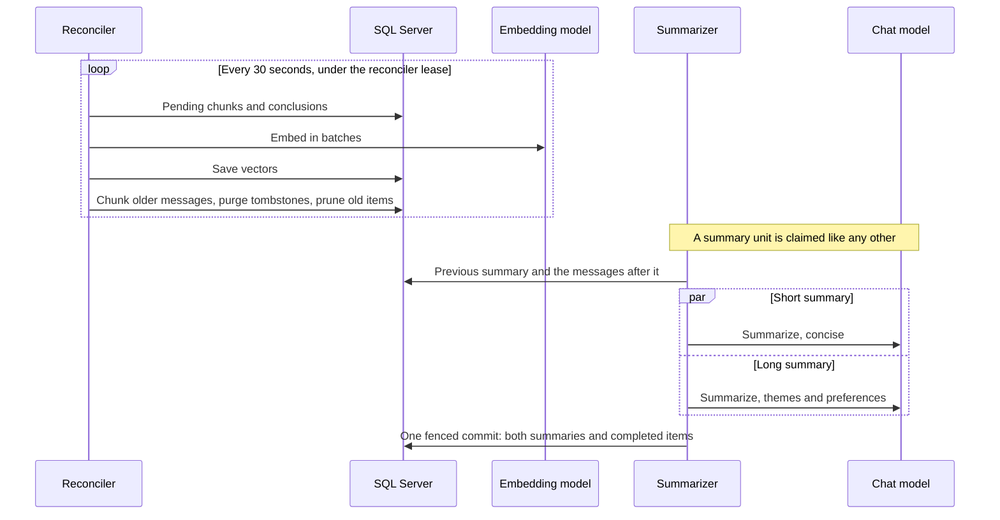
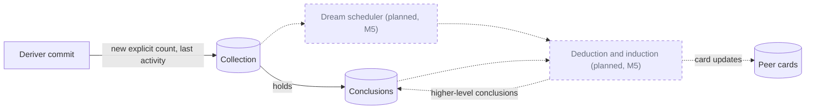

Posting a message stores it and, when its sender has an observer, queues one unit of
work. A background **worker** later turns that work into **conclusions**: short
statements about a peer that other calls can list, query and read back as a
representation. Nothing in this path runs inside your request. Which peers form memories of a
message is decided when it is stored; see [Observation model](/nachos/concepts/observation-model/).

**Diagram key.** Solid boxes and arrows are built today. Dashed boxes and arrows marked
*(planned)* are designed but not built yet; the label names the milestone. In sequence diagrams,
dotted frames (`loop`, `par`) only group steps.

## The pipeline

The numbered arrows follow these steps:

1. **Store and enqueue (1 to 3).** The append allocates sequence numbers, makes the senders
   members, stores the messages, and inserts one `representation` work item per message that has
   an observer, all in one transaction (with SQL Server and in memory alike). The item snapshots
   the observers and the message's own `reasoning` settings. The same transaction stores the
   messages' pending chunks for [search](/nachos/concepts/search/) (when an embedding model is
   configured) and, when a summary threshold is crossed, a `summary` work item.
2. **Eligibility (the note).** Work is grouped into units per workspace, session and sender
   (`representation:{workspace}:{session}:{sender}`). A unit becomes due when its pending messages
   reach `Nachos:Deriver:EligibilityTokens` (512 by default) or its oldest message is
   `Nachos:Deriver:MaxAge` old (30 minutes by default).
3. **Lease (4 and 5).** A consumer loop claims a due unit by taking its lease row and raising the
   row's **fencing token**, and keeps renewing the lease while it works. A unit is held by one
   lease at a time and runs oldest item first; different units run in parallel. If the worker
   dies, the lease expires, and the next claimer raises the token again, so the old worker can no
   longer commit.
4. **Deriver (6 to 8).** The worker sends the sender's messages, marked as targets, with recent
   messages of the session as context. The chat model returns facts about the sender, each naming
   the target messages it came from; facts that cite anything else are dropped. Other speakers'
   messages are context only. Reasoning can be turned off per message, session or workspace. In a
   batch that mixes enabled and disabled messages, the disabled ones are sent as context and only
   the enabled ones are targets; a batch where every message is disabled is completed without
   calling a model.
5. **Deduplication (9 and 10).** Each fact is embedded, then compared, for each observer, with
   that observer's conclusions about the sender from the same session: an exact match first, then
   the nearest by embedding. A fact within `Nachos:Deriver:DedupMaxDistance` (cosine, 0.05 by
   default) corroborates that conclusion instead of inserting a copy, and raises its
   `times_derived` (a retried batch does not raise it twice; filtering conclusions on
   `times_derived` is a Nachos extension). When the new fact is richer than the stored one, it
   replaces the conclusion's content. Existing conclusions are compared after extraction; they are
   not sent to the model.
6. **Commit (11).** One transaction checks the fencing token, checks that the workspace and session
   are not being deleted, completes the work items, and writes the new conclusions, corroborations
   and replacements. A crash leaves either all of it or none of it, and a worker that lost its
   lease writes nothing. Under a session that is being deleted, the result is discarded and the
   items complete.

The same consumer runs the other queued work: the session **summarizer** (see
[Session context](/nachos/concepts/session-context/)) and **deletion jobs** (see
[Delete sessions and workspaces](/nachos/guides/delete-data/)). The summarizer reads the
previous summary of each kind and the messages after it; when both kinds are due it asks for them
at the same time, and saves both, with the completion of its items, in one fenced commit.

A **reconciler** runs alongside the consumer. It embeds conclusions that were created
without a vector (for example through the API while a model was unavailable) and message
chunks for [search](/nachos/concepts/search/), chunks messages stored before chunking existed, purges
tombstoned conclusions, old completed queue items and expired idempotency keys after
their retention period, reports the queue backlog gauges, and runs as a singleton
through its own lease.

Failures retry with exponential backoff. After `Nachos:Deriver:MaxAttempts` (5) the items
are dead-lettered and reported as completed by `queue/status`, so a poisoned message does
not block the rest of the queue. A model that is down, throttling or timing out, a
transient SQL failure (such as a deadlock or failover) and a model authorization failure
do not use up attempts: the unit is released and retries for as long as the outage lasts. [Run the
worker](/nachos/guides/run-the-worker/) shows how to redrive dead-lettered work.

## Planned: dreaming

The commit already keeps two counters on each (observer, observed) collection: how many new
explicit conclusions it has and when it last changed. They are the hook for **dreaming**, a later
pass that reads a collection's conclusions and writes deductions, inductions and peer-card updates
back. Nothing reads the counters yet.

## What you can read back

| Call | Returns |
| --- | --- |
| `POST /v3/workspaces/{id}/conclusions/list` | Conclusions, filtered and paged. |
| `POST /v3/workspaces/{id}/conclusions/query` | The nearest conclusions to a text query, by embedding distance. |
| `POST /v3/workspaces/{id}/peers/{id}/representation` | A peer's conclusions rendered as text, optionally searched. |
| `GET /v3/workspaces/{id}/peers/{id}/context` | The representation together with the peer card. |
| `GET` and `PUT /v3/workspaces/{id}/peers/{id}/card` | The peer card: a short list of stable facts that you maintain (dreaming, which will also update it, is not built yet). |
| `GET /v3/workspaces/{id}/queue/status` | Counts of pending, in-progress and completed work. |

You can also create conclusions directly with `POST /v3/workspaces/{id}/conclusions` and
delete them by id. Messages are read back through [search](/nachos/concepts/search/) and
[session context](/nachos/concepts/session-context/). Dialectic chat and dreaming are not
built yet and answer `501`.

## Fake AI is not memory quality

Without an Azure OpenAI endpoint, every host the repository starts for local use runs the
**fake AI**. It exists so the whole pipeline (queue, lease, dedup, embeddings, commit) can
run offline: its "model" returns each message of the speaker, verbatim, as one fact, and
its embeddings are deterministic hashes. Conclusions are therefore copies of messages, and
semantic distance only reflects identical text. To make local runs quick, the fake AI also
makes the Deriver eager: `Nachos:Deriver:EligibilityTokens` defaults to 1 and `Nachos:Deriver:MaxAge`
to 0, so a single short message is due at once. A group is due when **either** limit is met, so
to restore a delay you must set **both** keys explicitly; setting only one leaves the other eager.
The host logs a warning at startup whenever the fake AI is active. Outside the Development
environment it runs only when `Nachos:Ai:Mode` is `Fake`; without that setting or an endpoint,
the host refuses to start.

Real memory needs a model. Set `AzureOpenAI:Endpoint` (and the two deployment names) to use
your own Azure OpenAI resource; see [Run the worker](/nachos/guides/run-the-worker/). The
embedding deployment must produce 1536 dimensions, because the database stores
`VECTOR(1536)`; a host with another size fails at startup. For embeddings without a paid
service, a small model can run in-process instead; see
[Run Nachos with local embeddings](/nachos/guides/local-embeddings/).

Vectors from different models are not comparable, so a database holds one embedding model's
vectors and records which (its embedding stamp). Every host checks its configured model
against the stamp at startup and refuses to start on a mismatch. Moving a database to another
model (for example from the fake AI to a real one) takes `nachos embeddings reset --model <id>`,
which sends every vector back to the worker to be embedded again. Each conclusion's internal
metadata also names the model that embedded it (`embedding_model`).

A semantic read (`conclusions/query`, or a representation or context with `search_query`)
answers `503` when the host has no embedding generator or the embedding service is
unavailable; retry it later.

## Where the loops run

| Provider | Where the worker runs |
| --- | --- |
| SQL Server | In its own host, `Nachos.Worker`. The API never runs the loops. Replicas share the queue through leases. |
| In-memory | Inside the API process, because another process cannot see in-memory state. |

The in-memory provider is not durable, so its conclusions disappear with the process.

All options are in [Options](/nachos/reference/options/); the section "Memory formation: AI,
worker and reconciler" lists `Llm`, `Embeddings`, `AzureOpenAI`, `Worker` and `Reconciler`.
