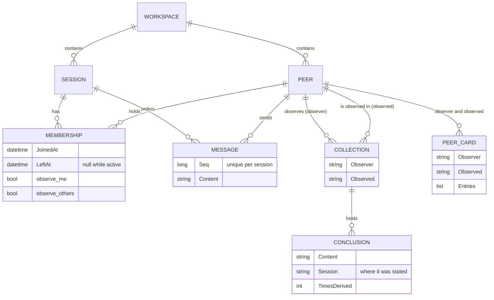
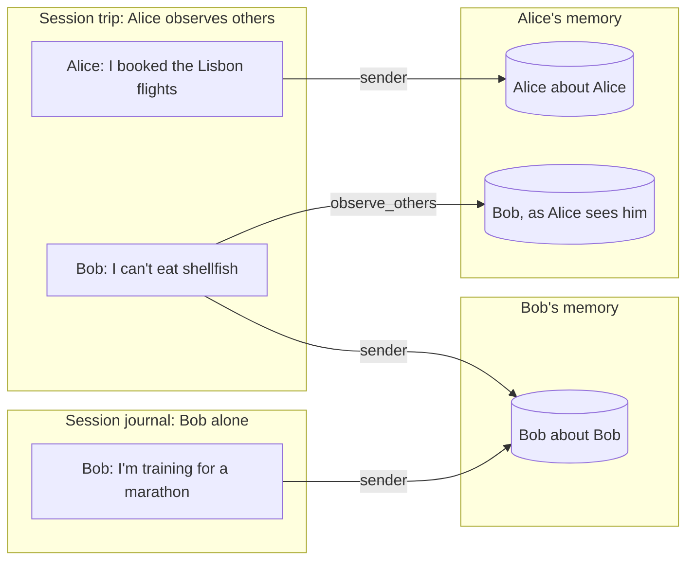
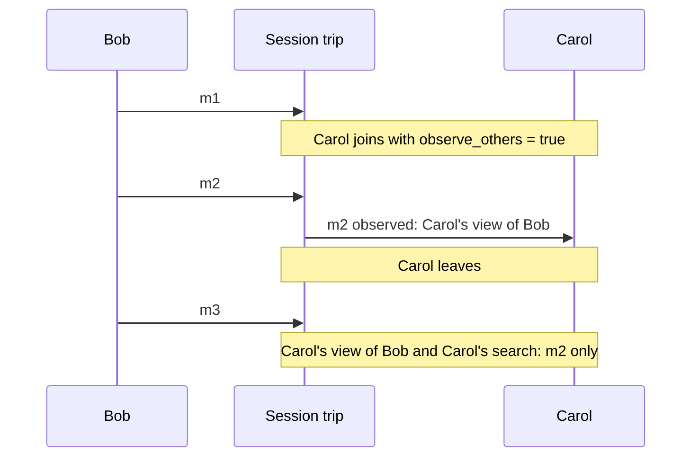
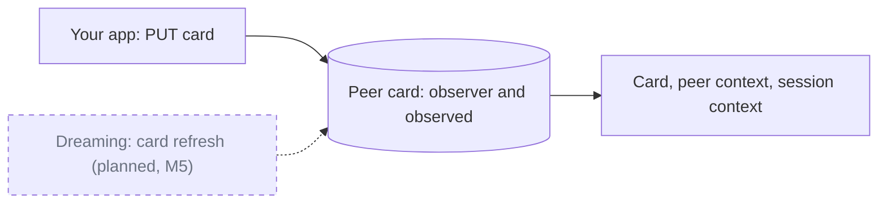
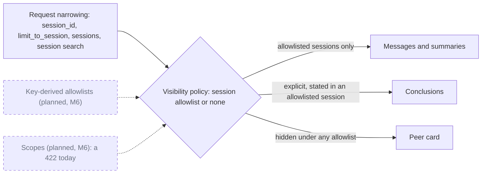

Nachos does not keep one global memory per peer. It keeps memory **per pair**: what an
*observer* peer has concluded about an *observed* peer. A peer's view of itself is the pair where
both are the same peer. A peer's view of someone else exists only when it was set up to observe
others and was present to see what they said.

**Diagram key.** Solid boxes and arrows are built today. Dashed boxes and arrows marked
*(planned)* are designed but not built yet; the label names the milestone.

## The entities

- A **workspace** is the boundary for everything below it; identifiers are case-sensitive.
- A **session** orders its messages by a server-assigned sequence number.
- A **membership** joins a peer to a session. It records when the peer joined and when it left,
  and carries the peer's `observe_me` and `observe_others` for that session. Sending a message makes
  the sender a member, if it is not one already. A peer has one membership per session: leaving
  sets `LeftAt`, and joining again starts a new window from that moment.
- A **collection** is one (observer, observed) pair. **Conclusions** live in collections, and each
  explicit conclusion remembers the session it was stated in.
- A **peer card** is a short list of stable facts, also kept per (observer, observed) pair.

## Who observes a message

When a message is stored, Nachos decides once, at that moment, which peers will form memories
from it. The answer is saved with the queued work, so later configuration changes do not rewrite
history.

1. If the sender's `observe_me` is `false`, at peer level or in its membership, **nobody** observes
   the message.
2. Otherwise the **sender** observes itself.
3. So does every **other member** that was active when the message was sent and whose membership
   has `observe_others: true`.

`observe_me` defaults to `true` and `observe_others` to `false`, so by default every peer forms
memories about itself only. `observe_me` can be set on the peer (`PUT /v3/workspaces/{id}/peers/{id}`
with `configuration`) or per session; `observe_others` is per session
(`PUT .../sessions/{id}/peers/{id}/config`, or the body of `POST .../sessions/{id}/peers`).

### Alice and Bob

Alice and Bob share session `trip`. Alice joined it with `observe_others: true`; Bob kept the
default. Bob also has a session of his own, `journal`.

- Alice's message reaches only Alice's own collection. Bob was present, but he does not observe
  others.
- Bob's message in `trip` reaches two collections: Bob's view of himself and Alice's view of Bob.
  Each gets its own conclusion, deduplicated against that collection only.
- Bob's `journal` message reaches only Bob's own collection. Alice was not there, so "Bob, as
  Alice sees him" knows nothing about the marathon.

A conclusion goes to an observer only when that observer saw **every** message it was drawn from.
To read the pairs back, name the observer in the path and the observed peer as `target`:

| Read | Alice about Bob | Bob about himself |
| --- | --- | --- |
| Representation | `POST .../peers/alice/representation` with `{"target": "bob"}` | `POST .../peers/bob/representation` |
| Peer card | `GET .../peers/alice/card?target=bob` | `GET .../peers/bob/card` |
| Peer context | `GET .../peers/alice/context?target=bob` | `GET .../peers/bob/context` |
| Conclusions | `conclusions/list` filtered on `observer_id` and `observed_id` | the same, with both set to `bob` |

How a message becomes a conclusion is in [Memory formation](/nachos/concepts/memory-formation/).

## Membership windows

Whether a peer counts as present is decided by its membership window at the time each message is
sent.

The same window limits peer-perspective [search](/nachos/concepts/search/): a peer finds messages of
its sessions sent while it was a member. Because a peer has one membership per session, joining
again moves `JoinedAt` forward, and messages from an earlier window drop out of that peer's search.
Conclusions already formed stay.

## Peer cards

A peer card is a short list of stable facts that one peer keeps about another (or about itself):
names, roles, standing instructions. Today **you** maintain cards with `PUT .../peers/{id}/card`,
optionally with `target`. Nachos stores the entries as given. The Deriver does not write cards.

A card sums up every session, so it cannot be attributed to any one of them. Any read restricted
to particular sessions therefore leaves the card out.

## Who can read what

Every read that returns memory takes one **visibility policy**, built per request. There is no
read path without one.

- **No allowlist**: everything the observer holds about the observed peer is visible.
- **With an allowlist**: only messages and summaries of the listed sessions, and only explicit
  conclusions stated in one of them. The card is hidden. An empty allowlist shows nothing.
- **Narrowing never widens.** A request's own narrowing is intersected with what the caller may
  already see.
- **Checked twice.** The store query is narrowed to the allowlist, and every result is checked
  again before it is returned.

Today the allowlist comes from the request: a representation's `session_id`, a session-scoped
search, or session context's `limit_to_session` and `sessions`. Which routes a key may call at all
is decided earlier, by [authentication](/nachos/guides/auth/). Scopes are rejected with a `422`
rather than read without their restriction.
