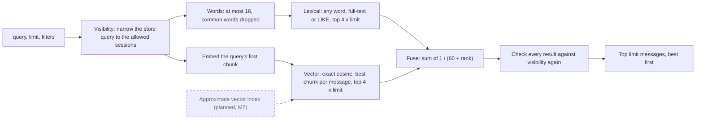

Message search is **hybrid**: every query runs a vector (semantic) search and a lexical
(word) search at the same time, and the two ranked lists are fused into one. A message that
has not been embedded yet is still found by its words.

## The three routes

| Route | Searches | Narrowest key |
| --- | --- | --- |
| `POST /v3/workspaces/{id}/search` | Every session of the workspace. | Workspace. |
| `POST /v3/workspaces/{id}/sessions/{id}/search` | One session. | Session, or the key of a peer that is an active member. |
| `POST /v3/workspaces/{id}/peers/{id}/search` | What the peer could have seen: messages of its sessions sent while it was a member (from when it joined until it left). | That peer's key. |

Workspace and admin keys can call all three. The body is
`{"query": "...", "limit": 10, "filters": {...}}` and the answer is a JSON array
of messages, best first.

- `query` is required (a missing one is a `422`). An empty or whitespace query returns `[]`.
- `limit` is 1 to 100 (default 10); anything else is a `422`.
- `filters` is a message filter, as on the message list, applied before ranking.
- `scope` on the workspace route is a `422` until scopes exist.

## How a query is ranked

**Diagram key.** Solid boxes and arrows are built today. Dashed boxes and arrows marked
*(planned)* are designed but not built yet; the label names the milestone.

The two retrievals run at the same time. With no word left after sanitizing, the lexical side is
skipped; with no embedding generator, the vector side returns nothing. Either way the other side
still answers.

1. **Vector.** The query is embedded (only its first chunk, so a very long query is never
   rejected by the model), and each candidate message is ranked by the cosine distance of its
   nearest chunk. The search is exact: every embedded chunk in scope is compared.
2. **Lexical.** The query is reduced to plain words (below), and a message matches when it
   contains **any** of them. Matches rank by how many distinct words they contain, then newest
   first.
3. **Fusion.** Each list retrieves `4 × limit` candidates. They are fused with reciprocal rank
   fusion: a message scores `1 / (60 + rank)` for each list it appears in, summed. Ties go to the
   newest message (by `created_at`, then by sequence), then the lowest public id. The top `limit`
   are returned.

Any-word matching lets a question such as "what did the user say about lemons" find a message
that only mentions lemons, because ranking rewards the messages that match more words.

### Words, not syntax

User text never reaches the full-text engine as syntax. The query is split into words (runs of
letters, digits and marks), lower-cased and deduplicated. About 60 very common English words
(`the`, `a`, `and`, `what`, `about`, …) are dropped unless nothing else remains, at most 16 words
are kept, and a word over 1,000 characters is dropped. Quotes, `*`, `(`, `~` and the like only
separate words, and words such as `NEAR` or `AND` are searched as plain words. A query with no
word at all skips the lexical half; the vector half still runs.

## Lexical search on SQL Server

SQL Server uses its **full-text index** when the server has Full-Text Search installed. Nachos
creates the index itself, at runtime, on the first start against such a server: the database
project never contains it, so the same schema deploys where Full-Text Search is absent. Until
the index has finished its first population, and always on a server without Full-Text Search,
Nachos falls back to `LIKE`.

| | Full-text index | `LIKE` fallback |
| --- | --- | --- |
| A word matches | as a whole word or a word prefix | as a case-insensitive substring, also inside a word or in unspaced (for example CJK) text |
| New messages | found once change tracking has indexed them, usually seconds later | found at once |
| Cost | grows with how many messages contain the words | scans every message of the workspace for every word |

Both paths rank alike, by the number of words matched and then newest, never by full-text
`RANK`, so they order the same matches the same way. The `LIKE` path finds a superset. The
Aspire AppHost and the SQL Server tests run the Full-Text Search image built from
`eng/docker/mssql-fts`; Azure SQL has Full-Text Search built in.

The in-memory provider matches words as case-insensitive substrings, like the fallback.

## When a message becomes searchable

Posting a message stores its **chunks** in the same transaction: pieces of at most
`Embeddings:ChunkTokens` tokens (512 by default, capped by the embedding model's own limit) with
a 20% overlap. The worker's reconciler embeds pending chunks on each tick (every 30 seconds by
default), so a message joins vector results within about one tick. Lexical search sees it at
once with `LIKE`, or as soon as the full-text index has caught up.

Messages stored before chunking existed (by an M1 or M2 build) have no chunks. The reconciler
chunks them in batches of `Reconciler:BackfillBatch` (500) per tick, and lexical search finds them
in the meantime.

## Without an embedding model

A host with no embedding generator searches lexically only and logs that once at startup; search
is not an error then. A transient failure of the embedding service is a `503` with
`Retry-After`, as for the other semantic reads.

## Scale

Vector search is exact, so its cost grows with the number of embedded chunks in scope. A
session-scoped search reads only that session's chunks; a workspace search reads them all. The
measured latencies at up to a million messages, and the decision taken on them, are in the
[M3 search benchmark](https://github.com/brendankowitz/nachos/blob/main/research/m3-search-benchmark.md).
Approximate (ANN) vector search is planned for a later milestone.
