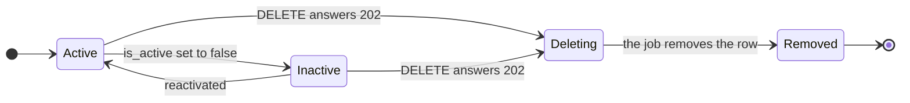
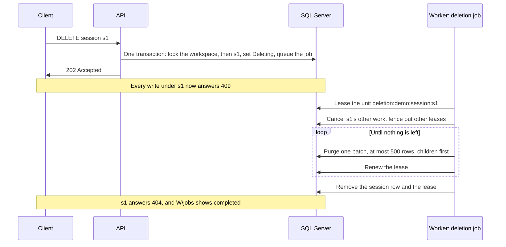
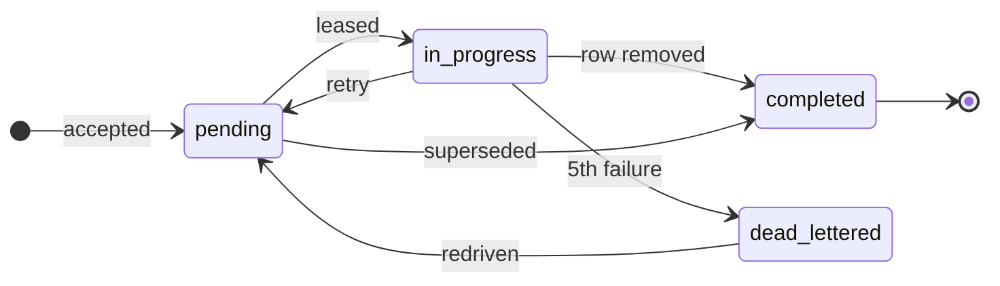

Deleting a session or a workspace is **accepted**, not finished, when the call returns. The API
answers `202 Accepted` with no body, the resource stops taking writes at once, and a background
**deletion job** removes its data in batches. `GET /v3/workspaces/{id}/jobs` shows how the job is
doing.

**Diagram key.** Solid boxes and arrows are built today. In sequence diagrams, dotted frames
(`loop`) only group steps.

A session moves through these states. While it is `Deleting` it reads as `is_active: false`, every
write under it answers `409`, and a repeated `DELETE` answers `202` for the same job. Once removed it
answers `404` and its name is free. A workspace has the same `Deleting` state.



## Delete a session

```bash
curl -s -X DELETE http://127.0.0.1:5080/v3/workspaces/demo/sessions/s1 -w "%{http_code}\n"
```

- The session reads as `is_active: false` immediately.
- Every write under it (messages, membership, updates, a get-or-create of its name) is a
  `409 {"detail": "session is being deleted"}` until the job has removed it, and a `404`
  afterwards. The name can then be used again.
- Deleting it again while the job runs is another `202` for the same job.
- The job removes the session's message chunks, summaries, its conclusions, its pending work,
  its memberships and its messages. A conclusion from elsewhere whose every source conclusion is
  removed is tombstoned (hidden from reads), not deleted.
- The session's job stays in the workspace's job list after the session is gone.

## Delete a workspace

```bash
curl -s -X DELETE http://127.0.0.1:5080/v3/workspaces/demo -w "%{http_code}\n"
```

- While the workspace has an active session, the answer is `409`: delete its sessions first. A
  session that is inactive or already being deleted does not count.
- Once accepted, every write in the workspace is a `409`, and a repeated delete is a `202` for the
  same job.
- The job supersedes the workspace's pending session jobs (they complete with
  `superseded_by_workspace_deletion`), then removes every session's data, the conclusions,
  collections, peer cards, idempotency records, the workspace's grants and its peers, and finally
  the workspace and its jobs.

`DELETE /v3/workspaces/{id}/conclusions/{id}` is different: it tombstones one conclusion at once
and answers `204`.

## What the job does



Cancelling other work deletes the session's pending work items and raises the fencing token of
every other lease on its work, so a Deriver or summarizer that is still running cannot commit a
result for it. Its own deletion unit is left alone.

## Watch the job

`GET /v3/workspaces/{id}/jobs` is a Nachos extension, so Honcho's SDKs have no method for it. It
takes the usual `page`, `size` and `reverse` parameters (oldest first by default; `cursor` is a
`422`) and needs a workspace key. Each job is:

```json
{
  "id": "42",
  "type": "deletion",
  "target": { "kind": "session", "id": "s1" },
  "status": "in_progress",
  "attempts": 1,
  "error": null,
  "created_at": "2026-11-09T10:00:00+00:00",
  "completed_at": null
}
```

`status` is `pending`, `in_progress`, `completed` or `dead_lettered`. `id` is the job's work item
id in the database.



A failed attempt goes back to `pending` and is retried after a backoff; an outage that releases
the job does not count as an attempt. A session's job that was still pending when its workspace was
deleted completes with the error `superseded_by_workspace_deletion`.

**`error` names only the failure type**, as `handler_failed: <exception type>` (for example
`handler_failed: Microsoft.Data.SqlClient.SqlException`), never its message. The full reason is in
the worker's logs, where each failure is logged as `Work unit {WorkUnitKey} (items
{WorkItemIds}) failed on attempt {Attempt}…` with the exception. Match the log entry by the job's
`id` (one of the work item ids) or by its work unit key, `deletion:{workspace}:{kind}:{id}`, for
example `deletion:demo:session:s1`.

## What deletion does not do

- **Keys are not revoked.** A peer- or session-scoped key names its peer or session by name, so
  it keeps working against a later peer or session created with the same name. Issue scoped keys
  with `expires_at`, or rotate the signing key to revoke every key at once.
- **Idempotency records outlive a deleted session for up to 24 hours.** Each record holds the
  captured response, including message bodies, and is removed when it expires or when its
  workspace is deleted. Replaying the key against a recreated session of the same name answers
  `422`, never the old response.
- **Reads of a session in `Deleting` are not all hidden yet.** Search leaves it out, but
  `GET .../context`, `GET .../summaries` and the message list still read it and can return
  partially purged data until the job removes the session.

## Where the job runs

With SQL Server the job runs in the [worker](/nachos/guides/run-the-worker/), so a deletion stays
`pending` until a worker is running. With the in-memory provider it runs inside the API process.
Each batch is one transaction of at most `Deletion:BatchSize` rows (500 by default, at most 4,000),
deleted children first. The job keeps no separate checkpoint: if a worker dies mid-way, the job is
retried and carries on from whatever rows are left, in any worker process.

## When a job fails

A failed job is retried with the worker's backoff, like any other work, and a database or model
outage does not use up its attempts. After `Nachos:Deriver:MaxAttempts` (5) attempts it is
dead-lettered: `W/jobs` shows `dead_lettered` with the error, and the session or workspace stays
in its deleting state, so writes stay blocked.

Find the cause in the worker logs, fix it, and return the job to the queue with SQL. There is no
command for this yet. Run it against the Nachos database as a user that can write
`dbo.WorkItems`; the worker picks the job up on its next poll:

```sql
-- The job's id from W/jobs; Status 3 is dead-lettered.
SELECT Id, WorkUnitKey, Attempts, Error, CompletedAt
FROM dbo.WorkItems
WHERE Id = 42 AND Status = 3;

UPDATE dbo.WorkItems
SET Status = 0, Attempts = 0, AvailableAt = SYSDATETIMEOFFSET(), CompletedAt = NULL, Error = NULL
WHERE Id = 42 AND Status = 3;
```

The job resumes from the rows that are left. The in-memory provider has no equivalent: restart
the API to start over. [Run the worker](/nachos/guides/run-the-worker/) covers redriving other
dead-lettered work.
